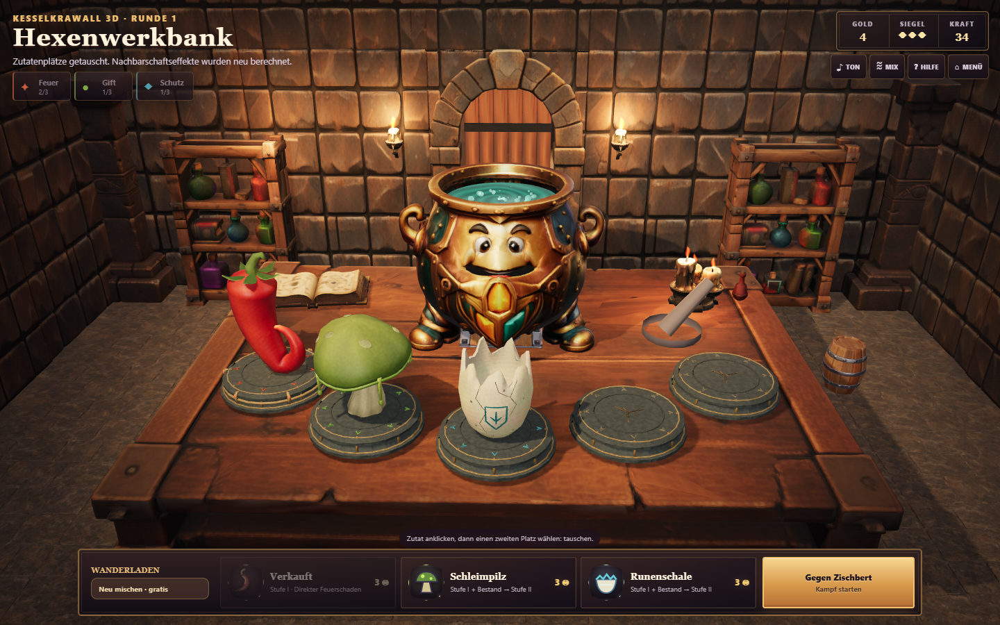
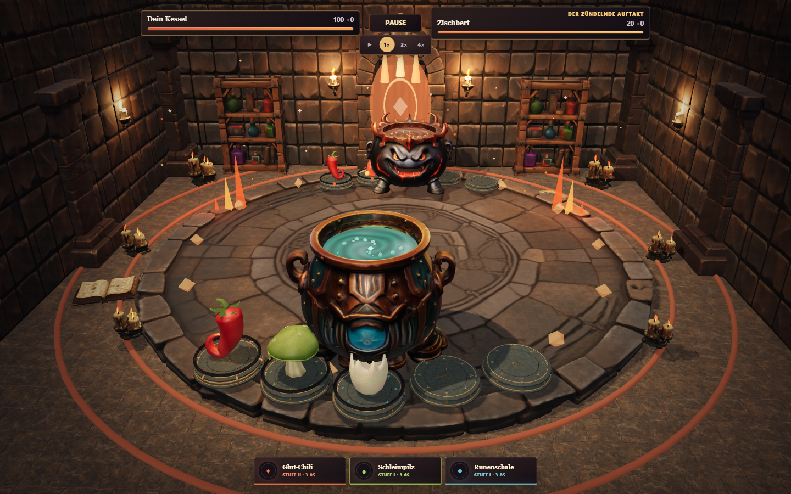
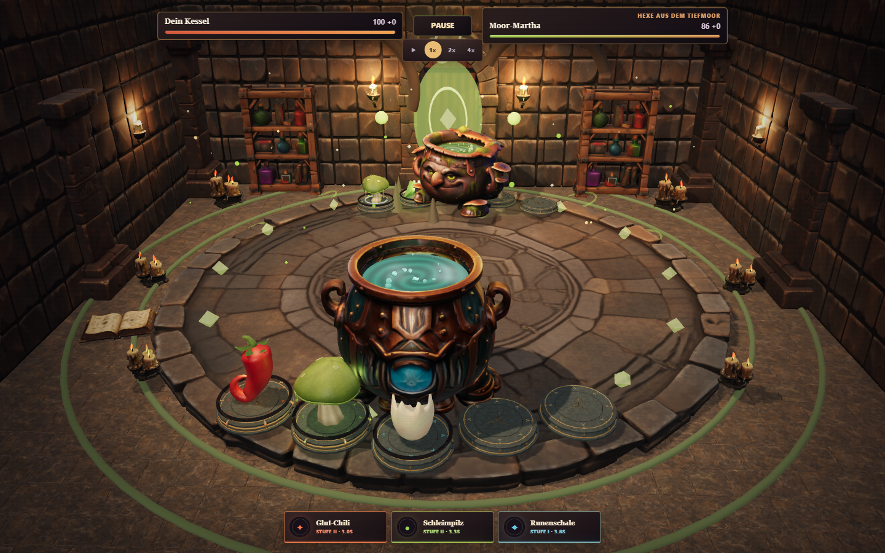

# KesselKrawall 3D

Fantasy-Autobattler mit alchemistischer Werkbank, kombinierbaren Zutaten und
charaktervollen Kesseln. Eigenständiger 3D-Rebuild von **KesselKrawall / Cauldron
Rumble**, umgesetzt mit TypeScript, React, Three.js und Vite.

## Spielen

**[KesselKrawall 3D im Browser spielen](https://emfau88.github.io/KesselKrawall-3-D/)**

Kein Konto oder Backend erforderlich. Spielstand und Fortschritt werden lokal
im Browser gespeichert. Desktop sowie mobile Portrait-/Landscape-Layouts sind
vorhanden; Browseremulation ersetzt keine Freigabe auf echten Smartphones.

`master` enthält den freigegebenen Entwicklungsstand und wird nach erfolgreichen
CI-Prüfungen über GitHub Pages veröffentlicht. Die ausgelieferte Revision steht
in der [Build-Identität](https://emfau88.github.io/KesselKrawall-3-D/build-info.json).

## Aktueller Stand

Der normale Aufruf **ohne URL-Parameter** verwendet die bereits erarbeitete neue
Raumkomposition, **B – Warm Fantasy**, Basalt-Messing-Podeste und den
Phase-3A.1-Zutatenpolish. Beide Rendering-Performance-Korrekturen sind enthalten.

- Geschlossene Werkstatt-/Arenaräume mit perspektivischer Desktop-/Mobile-Komposition.
- Brasskin sowie aus den ursprünglichen 2D-Vorlagen rekonstruierte Gegner
  Zischbert und Moor-Martha, lebendiger Trank und vorhandene Charakteranimationen.
- Glut-Chili, Schleimpilz und Runenschale als Qualitätsmuster mit Stufen I–III
  und integrierten Upgrades; die übrigen 17 Zutaten bleiben unverändert.
- Kauf mit Flug und Landung, Merge-Kaskaden, Platztausch, Reserve, Synergien
  und Nachbarschaftsbuffs.
- Deterministische Kämpfe mit VFX, Cooldowns, Schaden-/Statusanzeigen, Ergebnis
  und Rückkehr zur Werkbank; Kampagnenwahl, Grimoire, Anleitung und Audiooptionen.
- Stabile Lichtslots gegen nachgewiesene Shader-Kompilierungsblockaden bei
  Käufen/Merges; asynchrone Vorbereitung und getrennte Lichtverwaltung im Kampf.
- Gezielter Mobile-HUD-Pass für übliche Handygrößen: freie Werkbank-/Reserveplätze,
  kompakte Zutateninfos, sichtbare Preise/Merge-Stufen, modaler Audiomixer und
  getrennte Lebens-/Statusanzeigen und Kampfsteuerung.







## Vergleichsvarianten

Die alten Stände bleiben explizit auswählbar. Parameter lassen sich kombinieren.
Ohne `art` wird die neue Standardumgebung verwendet.

| Vergleich | URL-Parameter |
| --- | --- |
| Vorheriger Golden-Stand | `?art=golden` |
| KayKit / früherer Stand | `?art=legacy` |
| Quaternius-Bake-off | `?art=ecosystem` |
| Neue Standardumgebung explizit | `?art=mockup` |
| Phase-1-Referenzlicht | `?look=reference` |
| A – Dark Fantasy | `?look=dark` |
| B – Warm Fantasy | `?look=warm` |
| C – Magical Fantasy | `?look=magical` |
| Zutaten vor Phase 3A | `?ingredients=before` |
| Phase 3A ohne Polish | `?ingredients=phase3a` |
| Frühere GLB-Raumkomposition | `?composition=before` |

Beispiel: [früherer Golden-Stand](https://emfau88.github.io/KesselKrawall-3-D/?art=golden).
Die alten Varianten behalten ihre eigene Licht-/Materialsprache.

## Bekannte Grenzen

Der Werkbank-Audit erfasste nach dem Fix in 120 Kauf-/Merge-Aktionen höchstens
33,4 ms Frameintervall statt mehrsekündiger Interaktionsblockaden. Das ist
**keine allgemeine Ruckelfreiheitsgarantie**: Initialer Spielstart und neue
Materialvarianten können weiterhin stocken. Die Nulllichtslots erhöhen die
laufende GPU-Last; schwächere Geräte müssen gesondert geprüft werden. Auch die
Kampfvorbereitung schwankt. Details und reproduzierbare Daten stehen in den
QA-Berichten. Die North-Star-Mockups sind weiterhin ein Zielbild, keine bereits
vollständig erreichte Qualitätsstufe.

## Lokal entwickeln

Node.js ab 22.12 (CI: Node.js 24):

```bash
npm ci
npm test
npm run typecheck
npm run build
npm run dev
```

Für ein echtes Smartphone im selben WLAN: `npm run dev -- --host 0.0.0.0` und
die vom Terminal ausgegebene Netzwerkadresse öffnen. Experimente unter
`experiments/` gehören nicht zum veröffentlichten Runtime-Build.

## Entwicklung und Dokumentation

Kleine, risikoarme Korrekturen dürfen nach Prüfung direkt nach `master`.
Größere oder riskante Arbeiten erhalten einen temporären Branch und werden nach
Abnahme zeitnah integriert. Vollständig integrierte Branches werden anschließend
gelöscht; offene Arbeiten werden erhalten. [Vollständige Regeln](docs/DEVELOPMENT_WORKFLOW.md).

- [Konsolidierung, Branch-Audit und Integrationsabnahme](docs/qa/repository-consolidation/README.md)
- [Mobile-HUD: geprüfte Ansichten, Screenshots und verbleibende Grenzen](docs/qa/mobile-hud/README.md)
- [Werkbank-/Kauf-Performance: Diagnose, Messungen und Grenzen](docs/qa/workshop-purchase-performance/README.md)
- [Erstkampf-Performance: Ursache, Fix und Traces](docs/qa/first-combat-performance/README.md)
- [Zutaten-Polish und archivierte Vorher-Nachher-Vergleiche](docs/qa/ingredient-art-phase3a-polish/README.md)
- [Phase 3A](docs/qa/ingredient-art-phase3a/README.md), [Lichtvarianten](docs/qa/environment-lighting/README.md), [Raumkomposition](docs/qa/environment-composition/README.md)
- [Architektur](docs/ARCHITECTURE.md), [Legacy-Migrationsaudit](docs/LEGACY_MIGRATION_AUDIT.md), [bewusste Unterschiede](docs/BEHAVIOR_DIFFERENCES.md)
- [Asset-/Lizenzregister](docs/ASSET_LICENSES.md), [Charakter-Pipeline](docs/CHARACTER_RECONSTRUCTION.md), [Art Direction](docs/ART_DIRECTION.md)
- [Rendering-Roadmap](docs/RENDERING_REWORK_ROADMAP.md), [isolierter PlayCanvas-Bake-off](experiments/playcanvas/README.md)

Historische QA-Berichte beschreiben ihren damaligen Commit und damalige
Freigabegrenzen. Aussagen wie „opt-in“ oder „kein Pages-Release“ in diesen
Archiven sind keine Aussage über die aktuelle Veröffentlichung.
