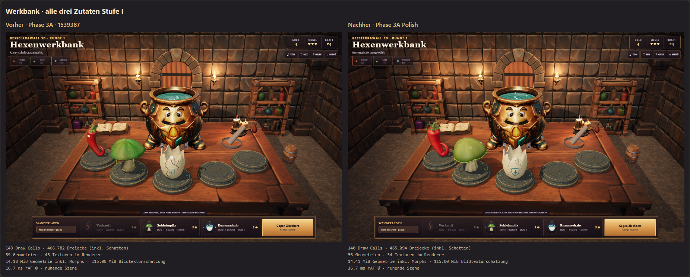
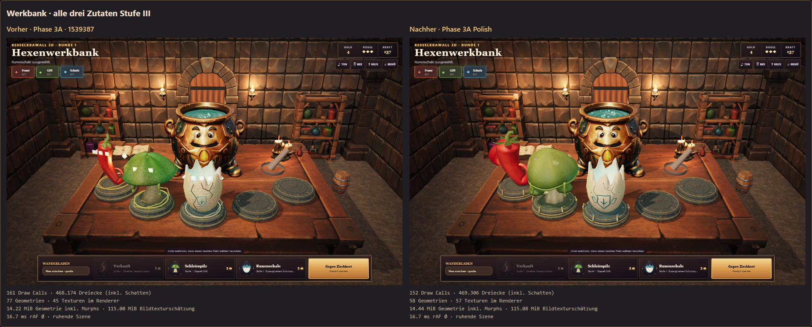
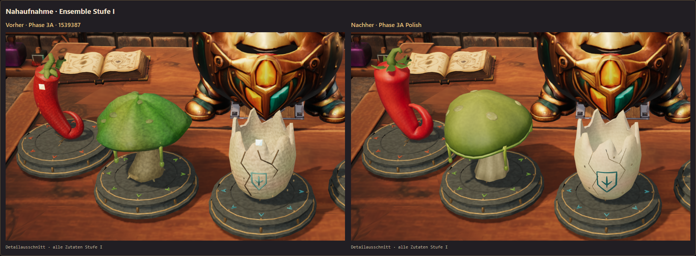

# KesselKrawall 3D

Eigenständiger 3D-Rebuild von **KesselKrawall / Cauldron Rumble** als statisch
deploybares Browsergame mit TypeScript, Vite, React, Three.js und
`@react-three/fiber`.

## Spielen

**[KesselKrawall 3D jetzt im Browser spielen](https://emfau88.github.io/KesselKrawall-3-D/)**

Desktop sowie Mobile Landscape und Portrait werden unterstützt. Das Spiel
läuft vollständig clientseitig und benötigt kein Konto.

### Werkbank-/Kauf-Performance auf dem Arbeitsbranch

`codex/workshop-purchase-performance` baut exakt auf dem Kampf-Fix `0456d1f` auf.
Eine gezielte Lichtslot-Verwaltung reduziert nachgewiesene Shader-Wartezeiten bei
Kauf und Merge; Modelle, Lichtwirkung, UI, Regeln und Animationstiming bleiben
erhalten. In 120 korrigierten Kauf-/Merge-Aktionen: maximal 33,4 ms Frameintervall,
keine mehrsekündigen Interaktionsblockaden. Initiale Start-Hänger und höhere
laufende GPU-Kosten bleiben dokumentierte Grenzen. Die Kampfregression wurde
auf Nutzerwunsch auf eine kleine Stichprobe gekürzt.

[Werkbank-Diagnose und technische Abnahme](docs/qa/workshop-purchase-performance/README.md) ·
[lokaler Produktionskandidat](http://127.0.0.1:5202/?art=mockup).
Kein Pages-Release, kein Merge nach `master`.

### Technische Erstkampf-Abnahme auf dem Arbeitsbranch

`codex/first-combat-performance` basiert exakt auf dem Zutaten-Polish `353d154`.
Der nachgewiesene Renderingfehler entsteht durch neue Shader-Varianten bei
wechselnden Effektlichtzahlen. Der gezielte Fix stabilisiert deren Anzahl mit
Nulllicht-Slots und bereitet die tatsächlich montierte Arena asynchron im
bestehenden Lade-Gate vor. Reale Beleuchtung, Grafikassets, UI und Spielregeln
bleiben erhalten. Werkbank- und Kaufhänger sind damit nicht pauschal behoben.

[Diagnose, Traces und vollständige technische Abnahme](docs/qa/first-combat-performance/README.md) ·
[lokaler Produktionskandidat](http://127.0.0.1:5198/?art=mockup).
Dieser Arbeitsbranch ist kein Pages-Release; `master` wird nicht verändert.

### Zutaten-Polish auf dem Arbeitsbranch

`codex/ingredient-art-phase3a-polish` baut auf Phase 3A, Commit **1539387**, auf.
Ausschließlich Glut-Chili, Schleimpilz und Runenschale erhalten vollere bzw.
organischere Formen, abgestimmte Oberflächen und integrierte Upgrades I–III.
Die Basalt-Messing-Podeste bleiben erhalten; ab Stufe II kommt eine veredelte
Fassung hinzu. Die schwebenden Stufensteine entfallen nur bei diesen drei Zutaten.
**B – Warm Fantasy**, Spielregeln, Kamera, UI und Umgebung bleiben unverändert.
Desktop-/Mobile-LODs entstehen reproduzierbar mit der bestehenden Blender-Pipeline.

[Polish lokal spielen](http://127.0.0.1:5173/?art=mockup) ·
[1539387 vorher spielen](http://127.0.0.1:5173/?art=mockup&ingredients=phase3a) ·
[Vorher-Nachher: Desktop, Mobile, Stufen und Einzel-Nahaufnahmen](http://127.0.0.1:5173/docs/qa/ingredient-art-phase3a-polish/compare.html) ·
[Kritische Abnahme und Performance](docs/qa/ingredient-art-phase3a-polish/README.md).







Die Phase-3A-Assets bleiben mit `ingredients=phase3a`, die älteren Assets mit
`ingredients=before` erhalten. Die Lichtvarianten
`look=reference`, `look=dark` und `look=magical` sind weiterhin verfügbar;
Golden, Legacy und Ecosystem behalten ihre bisherigen Assets und ihr Licht.
Die [Phase-3A-Vergleiche](docs/qa/ingredient-art-phase3a/README.md) und
[Phase-2-Lichtvergleiche](docs/qa/environment-lighting/README.md) bleiben archiviert.
Die bekannten mehrsekündigen Hänger beim ersten aktiven Kampf sind nicht durch
diesen Assetpass behoben. Mobile-Aufnahmen sind PC-Emulation, keine Gerätefreigabe.
Der Polish endet zur visuellen Abnahme: kein Merge nach `master`, kein Pages-Release.
Die Formensprache ist weiterentwickelt, Brasskins individuelle handgemalt wirkende
Oberflächenqualität aber noch nicht vollständig erreicht. Keine automatische
Freigabe für die übrigen 17 Zutaten; Details und Grenzen stehen im Abnahmebericht.

### Bisherige Raumüberarbeitung

Neun individuell aus den Mockups abgeleitete und vom Nutzer mit to3D konvertierte
Modelltypen und ein separat bereitgestellter 2-Meter-Steinboden sind jetzt als
**opt-in Vergleichsansicht** in Werkbank und Arena spielbar: insgesamt zehn
neue Assettypen. Die Original-GLBs und ihre Texturen bleiben erhalten; die technische
Aufbereitung ergänzt Normalen, korrigierte Metallwerte, Dochtanker und
Desktop-/Mobile-LODs. Phase 1 ergänzt nun geschlossene Wandanschlüsse,
Torbogenfüllungen, einen zurückgesetzten Raumabschluss und eine perspektivische
Kamera mit eigenen Desktop-/Mobile-Ausschnitten. Der archivierte Phase-1-Vergleich
isoliert diese Raum-/Kameraänderungen bei gleichbleibendem Licht.

Lokal: [neue Raumkomposition](http://127.0.0.1:5173/?art=mockup) ·
[vorherige GLB-Komposition](http://127.0.0.1:5173/?art=mockup&composition=before) ·
[interaktiver Bildvergleich](http://127.0.0.1:5173/docs/qa/environment-composition/compare.html).
[Phase-1-Abnahme und Testbericht](docs/qa/environment-composition/README.md) ·
[früherer Golden-vs-GLB-Vergleich](docs/qa/mockup-environment/README.md).
Der bestehende GitHub-Pages-Link oben bleibt der veröffentlichte `master`-Stand;
ein Push des Arbeitsbranchs ist noch kein Pages-Release.

Der Steinboden ersetzt jetzt die Übergangsböden und bewahrt seine drei PBR-
Texturen sowie die gelieferten LOD0-/LOD1-Geometrien. Der abschließende
VFX-/Asset-Polish bleibt offen. Phase 1 (`ae4e37e`) ist die unveränderte
Kompositionsbasis der Lichtvarianten, kein abgeschlossenes Mockup-Matching.
Im mobilen Querformat sind die vorhandenen Kampfsteuerungen kompakter angeordnet.
Die höhere Geometrielast ist im Phase-1-Abnahmebericht ausdrücklich benannt.

## Aktueller Stand

Legacy-Audit, renderer-neutraler Core, spielbarer 3D-Vertical-Slice und der
Blender-/North-Star-Art-Pass sowie Mobile-/UX-Polish sind umgesetzt. Der Lauf
führt vom Drei-Angebote-Shop über Kauf, sichtbaren Merge, Synergieanzeige und
Slot-Tausch in einen deterministisch simulierten 3D-Kampf mit HP, VFX, Ergebnis
und Rückkehr zur Werkbank. Legacy-Presentation-Code und die alte
2D-Sprite-Komposition bleiben ausgeschlossen. Das separat lizenzierte,
attribuierte Audiopaket wurde als kuratierter Runtime-Baustein übernommen.
Auf ausdrücklichen Nutzerwunsch dienen die ursprünglichen Einzelbilder von
Zischbert und Moor-Martha nun außerdem als Vorlagen für echte 3D-Rekonstruktionen.

Der aktuelle Golden Slice verwendet eine kuratierte, mobile-optimierte Auswahl
aus Quaternius Fantasy Props, Medieval Village und Stylized Nature als
gemeinsame visuelle Sprache. Der Spieler verwendet jetzt Brasskin: das
bereitgestellte texturierte 3D-Modell mit erhaltener Originalmimik, neutraler
Ruhestellung und getrenntem, dynamischem Trank. Zischbert und Moor-Martha
wurden aus ihren ursprünglichen 2D-Einzelbildern rekonstruiert und bewahren
ihre charakteristischen Formen. Die übrigen Gegner behalten vorerst die
modularen Donor-Kessel. Die reproduzierbare
Blender-5.2- und Asset-Aufbereitungspipeline liegt unter `art/blender/` und
`scripts/`. Hinzu kommen bewegtes Alchemistenpublikum, Ambient-Magie, klar
getrennte Cast-/Travel-/Impact-Phasen sowie ein Fantasy-UI-Pass mit dunklen
Schmiedepaneelen und Messingkanten.

Der P1-Golden-Encounter gegen Moor-Martha ergänzt eine vollständig eigene
Sumpf-Ritualarena, reaktionsfähige Kesselgesichter, große Zutaten mit echten
Cooldown-Ringen, item-spezifische Flug- und Klangprofile für alle 20 Zutaten,
eine gestufte K.-o.-Inszenierung und eine Ergebnis-Chronik, die Schaden,
Schild, Heilung, Gift und Auslösungen pro Zutat aufschlüsselt.

P2 rollt diesen Standard über die komplette erste Kampagne aus: Alle acht
Gegner besitzen nun charakteristische Kessel-Regalia, Arenamotive,
Farbdramaturgie, Signature-VFX und eigene Audioakzente. Der Shop zeigt echte,
individuelle Zutatenporträts statt Familien-Platzhaltern und verzichtet auf die
doppelte Angebotsdarstellung vor der Werkbank. Deutlich größere Modelle,
Runenringe und Stufensteine unterscheiden Level II und III dauerhaft. Im Kampf
haben Lebensleisten, Uhr, Effektbahn und Cooldowns Vorrang; Ressourcen und
Werkstattsteuerung werden auf Desktop und Mobile konsequent ausgeblendet.

P2.5A ergänzt eine vollständige Game-Shell vor dem eigentlichen Lauf: eine
animierte 3D-Titelszene, Kampagnenwahl, zustandsabhängiges Fortsetzen,
Zutatengrimoire, kompakte Spielanleitung, zentralisierte Audio-/Grafikoptionen
sowie Credits und Asset-Lizenzen. Ein neuer Lauf überschreibt den gespeicherten
Stand erst nach bewusster Kampagnenwahl; aus Werkbank und Ergebnisbildschirmen
führt jederzeit ein klarer Weg zurück ins Hauptmenü. Desktop, Mobile Portrait
und kurzes Landscape besitzen eigene, touchfreundliche Menükompositionen.

Käufe werden als abgeschlossene Präsentationstransaktion gezeigt: Flug,
Landung, jede Stufe einer Merge-Kaskade und erst danach die endgültige
Inventaransicht. Zutaten tragen sichtbare Stufenmarker; ausgewählte Zutaten
zeigen Takt, Wirkung und ihre ausgehenden beziehungsweise empfangenen Buffs
direkt auf der Werkbank. Im Kampf erscheinen gebündelte Schadens-, Heilungs-,
Schild- und Statuseinblendungen am betroffenen Kessel sowie kompakte
Buff-/Debuff-Badges in den Lebensleisten.

Zusätzlich enthalten sind Kampagnenwahl, Reservebedienung, gespeicherter
Shop-Run und Kampagnenfortschritt, Kurzeinführung, lizenzierte Musik,
Kessel-Ambience sowie räumlich gemischte UI-/Kampfsounds, Portrait-/Landscape-
Layouts, Touchsteuerung und ein installierbares Web-App-Manifest. Vor jedem
Kampf lädt ein sichtbares Preparation-Gate die kritischen Modelle und Texturen,
wartet auf den ersten vollständigen Arenaframe und startet erst dann die
deterministische Kampftimeline.

- Neues Arbeitsrepository: dieses Repository
- Nur lesbare Referenz während der Migration: separates lokales
  `KesselKrawall-reference`-Repository
- Auditierter Referenz-Commit: `5c4ec098b36d44d6dde4de31cba422de8b4f2b24`

Die Referenz ist Quelle für Regeln, Content und Balance, nicht für die neue
Presentation-Architektur. Insbesondere werden `Game.tsx`, die alte CSS-Struktur
und die 2D-Sprite-Komposition nicht portiert.

## Dokumentation

- [Neue Mockup-Assetpipeline: Batch 1 – vier GLB-Quellen, Audit und offene Einbauschritte](art/source/batch-01/TECHNICAL_REVIEW.md)
- [Neue Mockup-Assetpipeline: Batch 2 – priorisierte Raum-Assets und einzelne PNG-Vorlagen](art/source/batch-02/README.md)
- [Legacy-Migrationsaudit](docs/LEGACY_MIGRATION_AUDIT.md)
- [Zielarchitektur](docs/ARCHITECTURE.md)
- [Art Direction](docs/ART_DIRECTION.md)
- [Asset- und Lizenzregister](docs/ASSET_LICENSES.md)
- [Asset-Strategie: Phase-1-Audit und Beschaffungsentscheidung](docs/ASSET_STRATEGY_PHASE_1.md)
- [Asset-Strategie: Phase-2-Bake-off und Golden Slice](docs/ASSET_STRATEGY_PHASE_2.md)
- [Bewusste Verhaltensunterschiede](docs/BEHAVIOR_DIFFERENCES.md)
- [Mobile- und Performance-QA](docs/MOBILE_AND_PERFORMANCE_QA.md)
- [Production-Art-Review](docs/PRODUCTION_ART_REVIEW.md)
- [P1: Moor-Martha Golden Encounter](docs/P1_GOLDEN_ENCOUNTER.md)
- [P2: Golden-Encounter-Rollout des großen Kesselturniers](docs/P2_GRAND_TOURNAMENT_ROLLOUT.md)
- [P2.5A: Hauptmenü und Game-Shell](docs/P2_5_MAIN_MENU_GAME_SHELL.md)
- [Rendering- und Art-Direction-Rework: Master-Roadmap](docs/RENDERING_REWORK_ROADMAP.md)
- [Codebasierter PlayCanvas-Bakeoff: detaillierter Bulkplan](docs/PLAYCANVAS_CODE_BAKEOFF_PLAN.md)
- [Brasskin: lokale Kessel-Charakterprobe mit Mimik und lebendigem Trank](experiments/cauldron-character/README.md)
- [Charakter-Pipeline und Einbindung: Brasskin, Zischbert und Moor-Martha](docs/CHARACTER_RECONSTRUCTION.md)
- [Production-Art-Referenzen](docs/reference-art/README.md)

## Lokale Checks

```bash
npm install
npm test
npm run typecheck
npm run build
npm run dev
```

Für einen Test auf einem Smartphone im selben WLAN:

```bash
npm run dev -- --host 0.0.0.0
```

Anschließend die vom Terminal angezeigte Netzwerkadresse auf dem Smartphone
öffnen. Jeder Push auf `master` wird nach erfolgreichen Tests automatisch über
GitHub Pages veröffentlicht.

## Arbeitsphasen

1. Audit und Migrationsgrenzen
2. Renderer-neutralen Core bewusst extrahieren und testen
3. 3D-Greybox für Kamera, Licht, Werkbank und Arena *(umgesetzt)*
4. Shop, Merge, Synergie und deterministischen Kampf anbinden *(umgesetzt)*
5. Visuellen Vertical Slice mit Production-Art und Kampf-VFX ausarbeiten *(umgesetzt)*
6. Audio, Onboarding und Reaktionsqualität *(umgesetzt; echter Musik-/SFX-Mix)*
7. Responsive- und Performance-QA *(umgesetzt; Battle-Readiness-Gate und mobile Qualitätsstufe, physischer Gerätesmoketest empfohlen)*
8. Hauptmenü und Game-Shell *(P2.5A umgesetzt; Save-aware Fortsetzen, Grimoire, Anleitung, Einstellungen und Credits)*

Jede Phase muss ihren eigenen Quality Gate bestehen, bevor die nächste beginnt.
