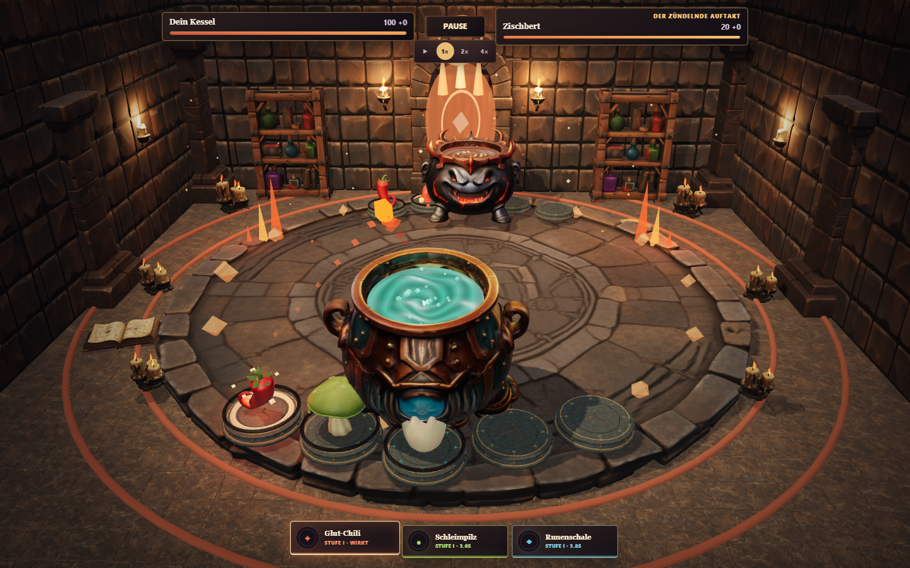
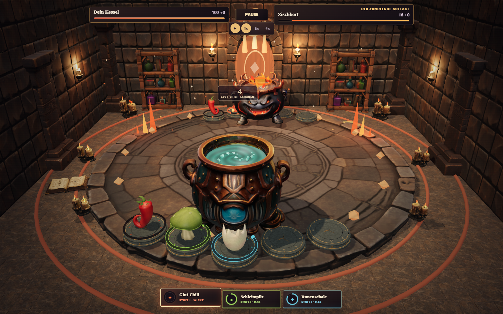
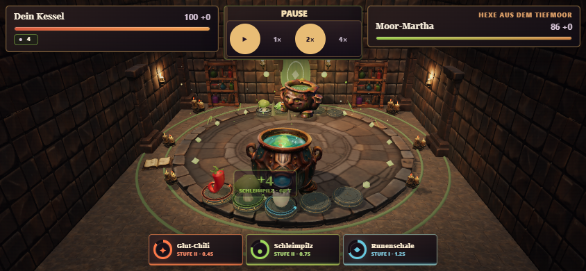

# Combat-Presentation-/VFX-Timing-Pass

Basis: `8fb1ade`, Arbeitsbranch `codex/combat-presentation-timing`.
Keine Änderungen am Simulationskern, an Balance, Assets, Kameras, Architektur
oder Lichtprofilen. `master`/Pages werden durch diesen Arbeitsbranch nicht ersetzt.

## Vorlage und Ursache

Vorlage: 2D-Original `emfau88/KesselKrawall`, Revision
`83d17ab14ff265559b58652e9040eecef7d7ad51`. Insbesondere
[geschützte Effektfenster](https://github.com/emfau88/KesselKrawall/blob/83d17ab14ff265559b58652e9040eecef7d7ad51/app/game/combatPresentation.ts#L586),
[gekoppelter Flug-/Einschlagzeitpunkt](https://github.com/emfau88/KesselKrawall/blob/83d17ab14ff265559b58652e9040eecef7d7ad51/app/game/Game.tsx#L1217)
und die gemeinsame, pausierbare Präsentationszeit.

Bisher wurden Kampfschritte beschleunigt, während 3D-VFX ihrer eigenen Echtzeituhr
folgten. Der nächste Event-Key entfernte laufende Projektile. Im normalen
beschleunigten Standard-Beat standen nominal 636 ms zur Verfügung; der Pilz
brauchte 940 ms für Vorbereitung/Flug. Einschläge begannen zudem bereits bei
78 % des Fluges, während Schaden/Sound/Reaktion schon beim Cast starteten.

## Begrenzte Umsetzung

- Eine pro Animationsframe fortgeschriebene Präsentationsuhr steuert VFX und
  kampfbezogene Charakter-/Zutatenbewegungen. React-Anzeigen bleiben weitgehend
  beim bisherigen 45-ms-Publikationstakt; Cast/Impact-Grenzen werden sofort
  publiziert. Keine React-State-Updates aus Three.js-Animationscallbacks.
- Ein verspäteter Frame trägt höchstens 100 ms vor Skalierung bei. Mehrsekündige
  Hintergrund-/Treiberpausen führen nicht zum Überspringen ganzer Angriffe.
  Das beseitigt keinen realen Render-Hänger, sondern verhindert visuelles Aufholen.
- Gemeinsame Timingprofile: Vorbereitung, vollständiger Flug, Kontakt, 360 ms
  Einschlag und mindestens 180 ms Nachlauf. Kein nächster Beat vor diesem Ende.
- HP/Schild/Statusanzeigen, Schadenszahlen, Kampfsound und Trefferreaktion warten
  auf den Kontakt. Der letzte Effekt startet beim KO nicht erneut.
- Status-Ticks erscheinen am Ziel statt als neue, unechte Flugprojektile.
- Zeitbasierte, ruhigere Rotation; auslaufende Flugspur und ausblendender
  Einschlag einschließlich seines vorhandenen Lichtimpulses.
- Pause friert Flug, Action-Pose und Schadenszahlen ein; Tempowechsel setzt den
  Flug nicht zurück. Umgebungsanimationen und natürliche Idle-Bewegungen bleiben
  absichtlich lebendig.
- Standardtempo 1× auch nach Runde 1. Eine explizit gewählte Geschwindigkeit
  bleibt für weitere Kämpfe erhalten; eine neue Kampagne beginnt wieder bei 1×.
- Weiterhin genau ein dargestellter Angriff zur Zeit, keine unbegrenzte VFX-Queue
  und keine zusätzlichen Lichtslots. Der bestehende Fünf-Slot-Vertrag bleibt bestehen.

## Abnahme

193 Tests in 29 Dateien bestanden, TypeScript und Produktionsbuild bestanden.
Neue reine Timingtests prüfen sämtliche 20 Zutaten bei 1×/2×/4× mit simulierten
30-/60-Hz-Zeitschritten, vollständigen Flug, Impact-/HP-Grenze, Pause, Tempowechsel,
Status-Ticks, verzögerte Frames und unveränderte Simulationsereignisse.
Die 30-/60-Hz-Tests sind keine gemessenen Geräte-FPS.

Der [Browsernachweis](report.json) prüft echte Three.js-Positionen und gerenderte
Effektgruppen nach dem Rendern, UI-HP-Anzeigen, native Pause-/Tempo-Handler,
Rückkehr zur Werkbank und den unveränderten Hash des vorberechneten Kampfergebnisses.
Es wurden keine Clock-, GL-, Ergebnis- oder Shader-Gate-Werte im Browser überschrieben.

| Fall | Beobachtete Effekte | Vorzeitig beendete Flüge | Max. echte temporäre Lichter | Max. aktives Frameintervall |
| --- | ---: | ---: | ---: | ---: |
| Desktop Zischbert 1× | 20 | 0 | 3 | 166,6 ms |
| Desktop Zischbert 4× | 20 | 0 | 3 | 66,6 ms |
| Mobile Landscape Moor-Martha 2× | 39 | 0 | 3 | 33,3 ms |

Alle 79 Effekte besitzen sichtbare Einschlagframes. Bei jedem reisenden Effekt
erreicht der Flug Fortschritt 1, bevor der Einschlag startet; Projektil-Endpunkt
und Einschlaganker stimmen auf weniger als 0,001 Welteinheiten überein.
HP-/Schildänderungen liegen nicht vor dem sichtbaren Kontakt (50-ms-Toleranz für
die abwechselnde DOM-/Renderbeobachtung; die reine Logik hat eine exakte Grenze).
Pause/Tempoänderung erhält Position, Rotation und Effektzeit. Keine neuen
JavaScript-/HTTP-/Assetfehler, keine aktiven Frameintervalle über 250 ms im finalen Lauf.

Chromium, Desktop 1440 × 900 und emuliertes Mobile Landscape 844 × 390, DPR 1,
Desktop-GPU. **Keine echten Smartphone-Tests und keine neue Performance-Messmatrix.**
Die vorhandenen Preparation-/Shader-Grenzen sind damit nicht generell beseitigt.

## Echte Ingame-Aufnahmen







## Grenzen und Nachvollziehbarkeit

Dies ist ein Timing-/Lesbarkeitspass, keine vollständige neue Partikel-Art-Direction.
Die bisherigen einfachen Effektmeshes und festen Zielanker bleiben erhalten;
filmischere Partikel, zusätzliche Trefferpunkte und komplexe Volley-Regie sind
eigene mögliche Folgearbeiten. Die Handlungstakte sind absichtlich vollständig
sichtbar statt beim nächsten Simulationsereignis abgeschnitten.

```powershell
npm test
npm run build
node scripts/qa_combat_timing.mjs --url=http://127.0.0.1:5210/
```

Vorher einen lokalen Preview-Server für den Produktionsbuild starten.
Playwright wird aus einer vorhandenen Installation oder der gebündelten
Codex-Prüflaufzeit geladen; keine neue Spiel-Runtime-Abhängigkeit.
