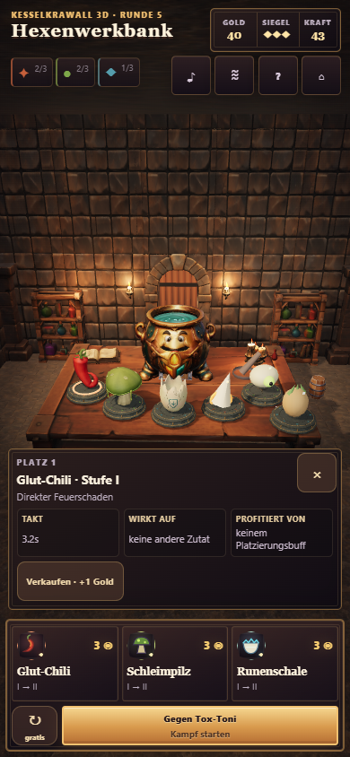
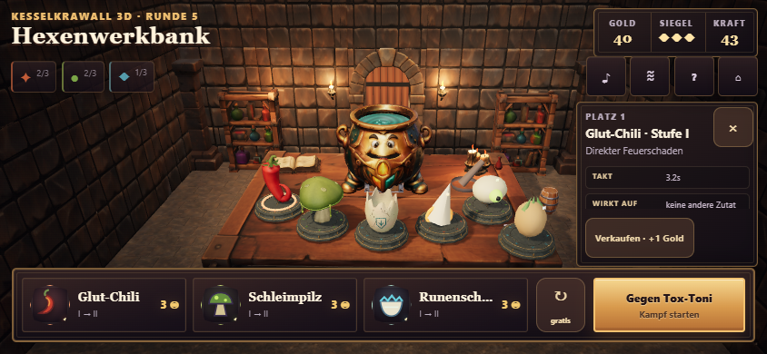
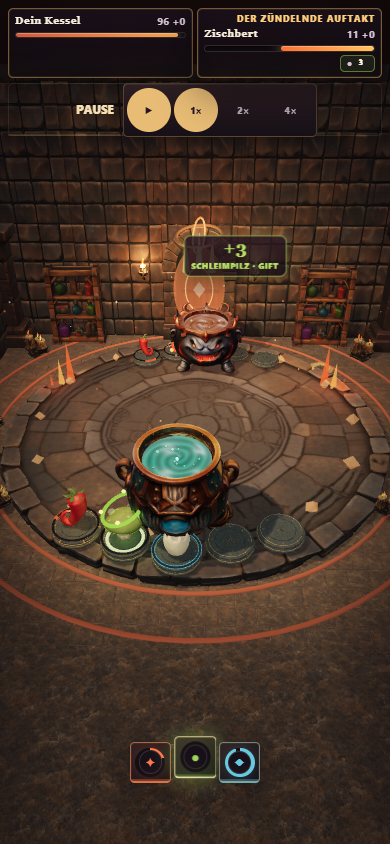

# Begrenzter Mobile-HUD-Pass

Basis: `c4e6dce`. Fokus auf übliche Handygrößen, keine Sonderoptimierung für
360 × 640 und kleinere Displays. Keine Änderungen an Kamera, Lichtprofilen,
Modellen, Texturen, Preisen, Merge-Regeln, Kampfsimulation oder Shader-Vorbereitung.

## Änderungen

- Portrait: Zutateninfo in der freien unteren Zone oberhalb des Shops, statt
  über Werkbank und Reserve. Drei kompakte Buff-/Taktfelder und Schließen-Button.
- Landscape: begrenzter rechter Infobereich unterhalb der Menübuttons.
  Schließen und Verkaufen bleiben sichtbar; nur der Informationsteil scrollt.
- Mobile-Angebote zeigen Preis und kurze Stufen-/Merge-Vorschau `I → II`;
  Portraitkarten erhalten mehr Platz für vollständige Namen.
- Audiomixer als nativer modaler Dialog mit Fokusführung, Escape und Schließen;
  Hintergrundkäufe/-aktionen sind gesperrt. Hilfe und Zutateninfo überlagern
  einander nicht mehr. Menübuttons haben 44 × 44 CSS-Pixel.
- Portrait-Kampf: Lebens-/Statusfelder und Playback-Steuerung belegen getrennte
  Grid-Zeilen, auch wenn Statusanzeigen die Höhe verändern.

## Prüfung

184 Unit-/Asset-/Regressionstests, TypeScript-Prüfung und Produktionsbuild bestanden.
Der vorhandene Desktop-Kauf-/Merge-Test besteht einschließlich Kaskade bis III,
Reserve-/Platztausch, Synergien sowie Speichern/Fortsetzen nach echtem Reload.

| Emulierter Viewport | Werkbank / Panels / Touch | Kauf / Merge / Tausch | Kampf mit aktivem Status | Ersatzmodus benötigt |
| --- | --- | --- | --- | --- |
| 390 × 844 | bestanden | bestanden | bestanden | nein |
| 844 × 390 | bestanden | bestanden | bestanden | nein |
| 430 × 932 | bestanden | bestanden | bestanden | nein |
| 932 × 430 | bestanden | bestanden | bestanden | nein |

[Mess-/Prüfdaten](report.json): Alle sechs projizierten Werkbank-/Reserve-Sockelpunkte
treffen die Canvas statt eines DOM-Panels. Info, Shop und Menü sind getrennt;
die Verkaufsaktion ist über ihre gesamte Höhe erreichbar. Drei Preise und drei
Merge-Hinweise sind sichtbar. Native Touch-Aktionen prüfen Reserve-/Platztausch,
Kauf und Merge. Der Mixer verhindert Hintergrundaktionen; Schließen/Escape und
gegenseitiger Ausschluss von Hilfe/Info sind geprüft. Im echten Kampf gegen
Zischbert sind Playback und Lebensfelder auch mit aktivem Giftstatus getrennt.
Keine beobachteten JavaScript- oder HTTP-/Assetfehler in der finalen Prüfung.

Die Statusaufnahme pausiert den laufenden Kampf automatisiert über den vorhandenen
Pause-UI-Handler beim ersten echten Statusereignis. Dies vermeidet ein Rennen mit
dem bereits nach sechs Sekunden beendeten Beispielkampf; keine geänderte Uhr,
künstlich eingefügten Statuswerte oder umgangene Shader-Vorbereitung.
Screenshots warten ausdrücklich auf Brasskin und die tatsächlichen GLB-Modelle,
nicht nur auf vorhandene Interaktions-Slots/Fallback-Geometrie.

Chromium mit Touch-/Viewport-Emulation, DPR 1, Desktop-GPU. **Keine physischen
Smartphone-Tests und keine neue Performance-Messreihe.** Der abschließende
Vier-Viewport-Lauf verwendet den regulären Preparation-Gate-Pfad ohne Ersatzmodus.

## Ingame-Screenshots







## Verbleibende Grenzen

- Kein Layoutversprechen für besonders kleine oder niedrige Displays.
- Im Querformat können lange Shopnamen weiterhin gekürzt sein; Preis und
  Merge-Ergebnis bleiben sichtbar. Lange Zutateninfos sind bewusst scrollbar.
- Der zuvor beobachtete Preparation-Gate-Timeout ist ein separates, hier nicht
  behobenes Zuverlässigkeitsproblem. Dass er in diesem Lauf nicht auftritt, ist
  kein Beleg für seine grundsätzliche Beseitigung.
- Bestehende Start-/Shaderkosten und die Geräte-GPU-Last bleiben unverändert.

## Reproduzieren

```powershell
npm test
npm run build
node scripts/qa_mobile_layout.mjs --url=http://127.0.0.1:5210/
```

Vorher den Produktionsbuild mit einem lokalen Preview-Server bereitstellen.
Der Browser benötigt Playwright; der Test nutzt bei Bedarf die bereits vorhandene
gebündelte Codex-Laufzeit. Keine zusätzliche Runtime-Abhängigkeit im Spiel.
