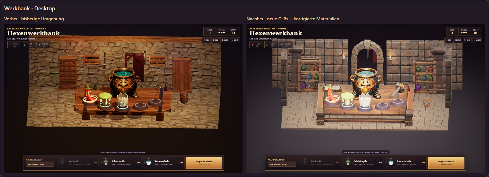
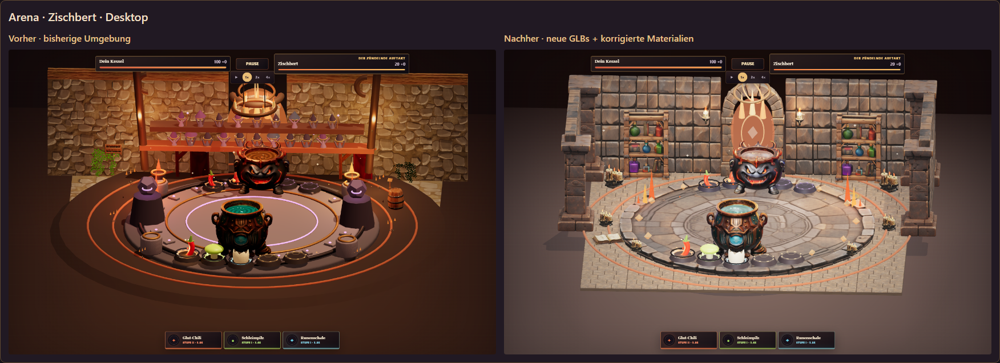

# Mockup-GLB-Vergleich – lokaler spielbarer Prüfstand

Stand: 13.10.2026. Zehn neue Assettypen einschließlich des gelieferten
Steinbodens sind technisch aufbereitet und als
isolierte Variante in das echte Spiel eingebunden. Der bisherige Golden-Stand
bleibt die Standardansicht. Core, Inventar, Balancing und gespeicherter Lauf
werden durch den Art-Schalter nicht verändert.

## Lokal öffnen

- [Neue Ansicht spielen](http://127.0.0.1:5173/?art=mockup)
- [Bisherige Ansicht spielen](http://127.0.0.1:5173/?art=golden)
- [Alle Ansichten nebeneinander](http://127.0.0.1:5173/docs/qa/mockup-environment/compare.html)

Bei einem vorhandenen Lauf „Fortsetzen“ wählen. Beide Spiel-Links nutzen
denselben lokalen Save; der Art-Schalter startet keinen neuen Lauf.

## Echte Vorher-/Nachher-Aufnahmen

Die Vergleichspanels zeigen unveränderte Spiel-Screenshots nebeneinander, als
HTML im Browser gerendert. Links ist immer vorher, rechts nachher. Keine
generierten Screenshots und kein nachträglicher Bild-Polish. Kamera, Viewport,
DPR, Startinventar und Gegner sind gleich. Kampfbilder wurden nach dem
Lade-Gate über den echten UI-Button pausiert; Ambient-Animation bleibt aktiv.





| Szene / Ansicht | Vorher | Nachher |
| --- | --- | --- |
| Werkbank · Desktop | [PNG](workshop-golden-desktop.png) | [PNG](workshop-mockup-desktop.png) |
| Zischbert · Desktop | [PNG](battle-zischbert-golden-desktop.png) | [PNG](battle-zischbert-mockup-desktop.png) |
| Moor-Martha · Desktop | [PNG](battle-moor-martha-golden-desktop.png) | [PNG](battle-moor-martha-mockup-desktop.png) |
| Werkbank · Portrait | [PNG](workshop-golden-mobile-portrait.png) | [PNG](workshop-mockup-mobile-portrait.png) |
| Zischbert · Portrait | [PNG](battle-zischbert-golden-mobile-portrait.png) | [PNG](battle-zischbert-mockup-mobile-portrait.png) |
| Moor-Martha · Portrait | [PNG](battle-moor-martha-golden-mobile-portrait.png) | [PNG](battle-moor-martha-mockup-mobile-portrait.png) |
| Werkbank · Landscape | [PNG](workshop-golden-mobile-landscape.png) | [PNG](workshop-mockup-mobile-landscape.png) |
| Zischbert · Landscape | [PNG](battle-zischbert-golden-mobile-landscape.png) | [PNG](battle-zischbert-mockup-mobile-landscape.png) |
| Moor-Martha · Landscape | [PNG](battle-moor-martha-golden-mobile-landscape.png) | [PNG](battle-moor-martha-mockup-mobile-landscape.png) |

## Umgesetzt und geprüft

- [x] Tisch, Steinplattform, Dreifachkerzen, Grimoire, Steinwand, Torbogen,
  bestücktes Regal, Wandkerzenhalter, Steinpfeiler und Steinboden sind echte GLBs.
- [x] 20 Desktop-/Mobile-Varianten: Bodenursprung, passende Größen/Achsen,
  seam-aware Normalen, expliziter Nichtmetall-Wert, erhaltene Texturen/UVs.
- [x] Roh-GLBs und eingebettete Original-PNGs bleiben byte-identisch erhalten.
- [x] Tiny UV-Ausreißer der LOD-Interpolation auf den Atlasrand begrenzt;
  keine neuen Texturen oder kreativen Ersatzmodelle erzeugt.
- [x] Flammen an gemessenen `Wick_L/C/R`- bzw. `Wick`-Nodes statt geratenen
  Positionen; animierte Laufzeit-Flammen und warme lokale Lichter.
- [x] Neue Arena wartet im Lade-Gate auf ihre sichtbaren neuen Modelle.
- [x] 156 technische Modellprüfungen, zehn Bodentests sowie 26 Tisch-/Podest-Checks.
- [x] 62 Vitest-Spieltests, Typecheck und Produktions-Build bestanden.
- [x] 36 Browser-Prüffälle: Kauf/Merge, beide Gegner, Pausieren/Fortsetzen,
  Ergebnis/Rückkehr, freie Kampfbahn, Desktop und beide Mobile-Orientierungen.
- [x] Alle zehn neuen Modelltypen in tatsächlichen Szenen nachgewiesen;
  keine fehlenden Asset-Requests, Runtime-Fehler oder horizontalen HUD-Überläufe.

## Performance und Grenzen

Chromium verwendete AMD Radeon über Direct3D11. Je Szenenaufnahme wurden 120
rAF-Intervalle nach 20 Warm-up-Frames gesammelt. Der erste Lauf ohne den später
gelieferten Boden lag etwa bei 60 FPS. Im abschließenden Lauf mit Boden lagen
die Mediane bei 16,7–33,3 ms, p95 bei 16,7–149,9 ms und die mittlere beobachtete
Bildrate bei 21,1–60 FPS über alle alten/neuen Ansichten. Auch die alte
Mobile-Landscape-Ansicht hatte starke Ausreißer. Scheduling, Hintergrundlast,
GPU-/Shader-Warmup und tatsächliche Szenenkosten sind damit nicht sauber
isoliert. **Keine stabile 60-FPS-Freigabe**, kein echter Smartphone-Benchmark
und kein Stress-Test vieler gleichzeitiger VFX. Die neue Arena reduziert Draw Calls,
erhöht aber die Render-Dreiecke. Zähler enthalten auch Shadow-Pässe.

| Zischbert-Aufnahme | Draw Calls vorher → nachher | Render-Dreiecke vorher → nachher |
| --- | ---: | ---: |
| Desktop | 781 → 413 | 247.928 → 694.750 |
| Mobile Portrait, emuliert | 643 → 378 | 189.087 → 374.658 |
| Mobile Landscape, emuliert | 674 → 402 | 205.556 → 386.646 |

Die neun to3D-Runtime-Assets je einmal: 80.887 Desktop-/40.391 Mobile-Dreiecke
statt 289.323 roh. Hinzu kommt ein Bodenmodul mit 5.072/2.432 Dreiecken,
inklusive unveränderter Farb-, Normal- und ORM-PNGs und Vertexfarben.
Reale Instanzen, Zutaten, Schatten und VFX kommen hinzu.
Rohmessungen: [report.json](report.json).

Die Richtung passt besser zusammen: Holz, Stein, Bücher und Wachs sind
eine gemeinsame Materialsprache. Der größere Tisch, echte Raumarchitektur
und gefüllte Regale sind sichtbare Schritte. Trotzdem ist es **noch nicht
das 1:1-Mockup-Ziel**.

- [x] Gelieferter 2-Meter-Steinboden mit originalem LOD0/LOD1 und PBR-Maps integriert.
- [ ] Finaler Licht-/Kontrastpass: stellenweise heller/flacher als die Mockups.
- [ ] Portal, Runenelemente, Zutaten-Podeste und manche VFX sind noch einfacher.
- [ ] Die neun to3D-Assets haben 1024²-Farbatlanten mit teils gebackener
  Schattierung; zusätzliche PBR-Materialsets fehlen bei diesen weiterhin.
  Der separat gelieferte Boden besitzt bereits Farb-/Normal-/MR-PBR-Maps.
- [ ] Reale Low-end-Handys, Touch-Komfort, Wärme und langsame Erstladung testen.
- [ ] Reproduzierbare Performance-Prüfung unter kontrollierter Last und weitere
  Reduktion von instanzierten Boden-/Deko-Dreiecken und Shadow-Pässen.
- [ ] Produktions-/Pages-Release nach visueller Abnahme.

Die primitive Tribüne entfällt nur im neuen Modus, weil sie den Torbogen
verdecken würde. Charaktere, Kampfabstand, Zutatenpositionen und Kameras
bleiben für den Vergleich erhalten. Kein Unity-/PlayCanvas-Umbau enthalten.

## Reproduzieren

```powershell
& 'C:\Program Files\Blender Foundation\Blender 5.2\blender.exe' --background --factory-startup --python art/blender/prepare_mockup_environment.py
node scripts/prepare_supplied_floor.mjs
node --test scripts/test_mockup_assets.mjs
node --test scripts/test_supplied_floor.mjs
npm test
npm run typecheck
npm run build
node node_modules/vite/bin/vite.js --host 127.0.0.1 --port 5173 --strictPort
node scripts/qa_mockup_environment.mjs
node scripts/render_mockup_comparison.mjs
```

Provenienz und LOD-Metriken: [Runtime-Manifest](../../../art/source/mockup-runtime-manifest.json).
